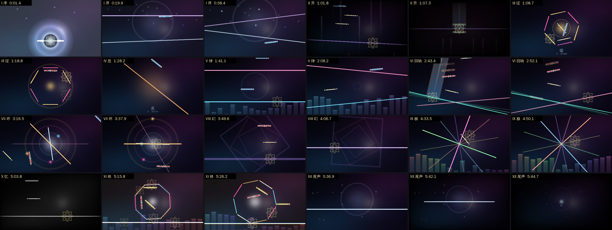
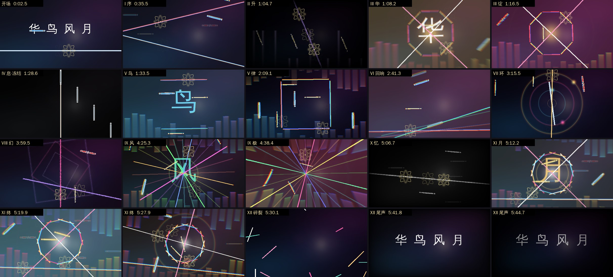
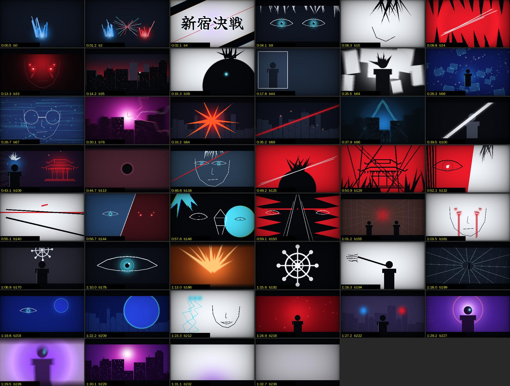
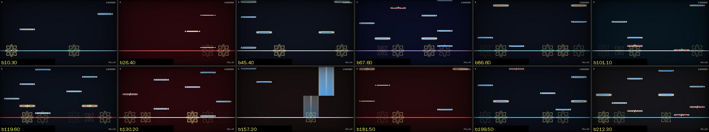
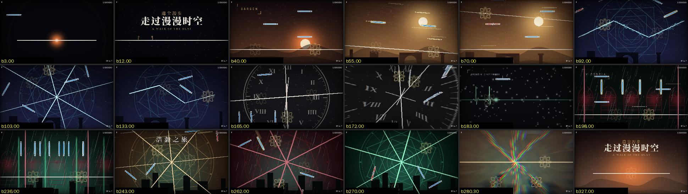

# 华鸟风月 · Phira 观赏谱

《华鸟风月》（曲：ZUN ／ 谱：Claude）的 Phira 观赏谱（RPE 格式），以「夜空与星轨」为主题，按歌曲本身的结构编排成十二个乐章。

本仓库另有《新宿决战》的两张谱：纯判定线演出（无 note），以及嵌入原 MAD 素材的 IN Lv.16（定数 16.2），见下文。
另有《走过漫漫时空》（《明日方舟》「遗尘漫步」OST）的特效观赏谱，见下文。

- 时长 5:47，BPM 123（全曲恒定，按节拍网格对齐），1238 个物量，137 条判定线，25 段着色器特效
- 难度标为 `SP Lv.?`，建议开启 Autoplay 观看



<sub>上图由仓库内的预览器按 Phira 的渲染规则绘制，仅作示意，与游戏内画面会有细微差别。</sub>

## 导入

这个仓库是公开的，所以**仓库里没有放音频和封面图**（`chart/` 里的 `illustration.jpg` 是程序生成的占位星空图）。可直接导入的完整包 `huaniaofengyue_showcase.pez`（含音乐与封面）已在对话中单独发给你，在 Phira 中选择「导入谱面」即可。

如需自己打包：把你的 mp3 和 `chart/` 目录里的全部文件一起压缩成 zip（文件位于压缩包根目录，mp3 命名为 `song.mp3`），后缀改为 `.pez`；或运行：

```bash
pip install numpy pillow pyyaml
python tools/gen/build.py out --song 你的歌曲.mp3 --cover 封面.jpg --pez huaniaofengyue_showcase.pez
# 暴力版：加上 --variant showcase_v2
```

## 暴力版（v2）

同一首歌、同样的十二段结构，所有方面加码，导入后与第一版并列显示（等级 `SP Lv.!?`）。完整包 `huaniaofengyue_showcase_v2.pez` 同样单独发送；谱面文件在 `chart_v2/`。

- 1798 个物量（第一版 1238），另有约 600 个装饰用假音符（音符雨、残影）；高潮段每秒约 9 个音符
- 全部判定线挂在一条「镜头」线下：鼓点震屏、整体倾斜，终章最后一小节整屏旋转一周
- 「华」「鸟」「风」「月」四个字分别砸在四个高潮的第一拍上；开场与结尾显示完整曲名
- 流速更高且不连续：「息」中音符悬停冻结一拍半后以 30 倍流速冲入；两段铺垫中判定线高速旋转并推到三十二分音符
- 判定线瞬移（幻）、快照式旋转（绽、律）、十二臂星芒（极）、十二瓣花（终），尾声开头所有线碎裂飞散
- 每小节冲击波、逐拍色差与频闪、像素化爆发、故障特效；设备较弱时建议关闭特效



## 十二乐章

| 乐章 | 开始 | 画面 |
|---|---|---|
| I 序 Prelude | 0:01 | 一点微光落下第一个音符，化作判定线；星辰闪烁，月环缓缓升起，第二条线在上方应答 |
| II 升 Ascent | 0:54 | 线沉到底部再一路上升，光束上涌、暗角收紧、音符加速，旋转一周后静止一拍 |
| III 绽 Bloom | 1:08 | 闪白与冲击波，六片花瓣绕发光的核心旋转，音符从中心向外绽放 |
| IV 息 Breath | 1:25 | 暖色单线缓慢转动，长条落在和弦上 |
| V 律 Pulse | 1:33 | 随鼓点跳动的双线，背后是由歌曲真实频谱驱动的均衡器 |
| VI 回响 Echo | 2:28 | 摆动的钟摆线与残影，重拍音符带拖尾 |
| VII 环 Orbit | 2:59 | 时针、分针、逐拍跳动的秒针；行星沿轨道运行 |
| VIII 幻 Mirage | 3:46 | 隐形判定线与汇聚的音符、线的翻转、只在近处显形的音符，伴随故障特效 |
| IX 极 Zenith | 4:25 | 六臂星芒旋转变色，鱼眼脉冲 |
| X 忆 Memory | 4:56 | 在灰阶中重演「升」，色彩在最后一拍回来 |
| XI 终 Finale | 5:12 | 八瓣花、均衡器与底线同时出现，全曲最密集的段落 |
| XII 尾声 Coda | 5:29 | 回到一条线、一个光点，月环重现，fin. |

## 新宿决战 · 纯判定线演出（MAD）

参考 NinjaristicNinja 的《新宿决战》静止画 MAD（B 站转载 BV1dGTu66Eo4，BGM 为《雨爱》DJ 版）做的无 note 演出谱。用判定线逐拍复刻原视频的剪辑节奏、配色和镜头语言。

- 时长 1:33，BPM 153.6，共 126 个镜头，切点与参考视频逐拍对应
- 冷蓝灰底色，青色代表五条、红色代表宿傩、紫色代表「茈」；穿插红色冲击帧和黑场停顿，结尾白场收束
- 画面全部是判定线拼成的线稿和几何图形：眼睛、火焰、斩击、闪电、天际线、无量空处的漂浮面板、伏魔御厨子、法轮、结印、虚式「茈」等
- 共 738 条判定线，由对象池轮流复用，每帧同时可见的最多约 70 条；另有 29 段着色器特效
- 分数、连击、暂停键、曲名等 HUD 通过 attachUI 挂在透明线上，播放时不显示
- 全谱只有一个 note，放在「茈」释放的那一拍。原因是 Phira 在 0 个 note 时准确率是 0/0。这个 note 是透明的，放在屏幕外，打击音换成了静音文件，演出中看不到也听不到。建议开 Autoplay 观看
- 原音频是 m4a，Phira 无法解码 MP4 容器，所以打包时转成了 OGG Vorbis
- 曲目信息按 B 站自动识别的「雨爱（DJ 版）」填写，可在 Phira 的谱面信息中修改



完整包 `shinjuku_showdown_mad.pez`（含音频）单独发送；谱面文件在 `chart_mad/`，不含音频。如需自行打包：

```bash
ffmpeg -i 原音频.m4a -vn -c:a libvorbis -q:a 7 song.ogg
python tools/gen/build.py out --variant mad_shinjuku --song song.ogg --pez shinjuku_showdown_mad.pez
```

## 新宿决战 · IN Lv.16（定数 16.2）

可玩的谱面，在四个名场面直接播放原 MAD 的画面（Phira 的谱面视频功能，`extra.json` 中的 `videos`）：

| 片段 | 拍 | 参考视频时间 | 内容 |
|---|---|---|---|
| 200% 虚式「茈」 | 73–82 | 0:29–0:33 | 屋顶 → 蓄力 → 爆炸 |
| 第一次领域对拼 | 105–113 | 0:42–0:45 | 宿傩结印 → 领域对拼 → 黑球 |
| 第二次领域对拼 | 144–154 | 0:57–1:01 | 分屏 → 青 / 红 / 黑白结印图形 |
| 无限制虚式 | 216–曲终 | 1:25–1:34 | 红色余烬 → 坠落 → 释放 → 白场 |

- 视频播放时只放动画：背景、判定线和 HUD 全部让开，没有 note；视频最后一拍判定线淡入，接上后面的谱面
- 其余约 73 秒：纯色暗底（只随段落变换色调），一条固定的判定线，note 落在铺满全宽的 7 条轨道上（左手 0–2、右手 4–6，中间轨用于和弦、扫键与连打）
- 710 个 note（tap 558、flick 83、drag 54、hold 15），平均每秒约 9.7 个，1 秒内峰值 17 个；节奏全部取自对歌曲 16 分网格的起音分析（`tools/data/mad/steps.npz`），高潮段为满 16 分
- `tools/gen/playcheck.py` 按双手模型检查了整张谱：没有 3 个以上同时触点，没有重叠 note，没有单手快于 16 分的连打或过远的跳跃

**仓库里没有视频素材和音频**（素材来自 NinjaristicNinja 的作品）。`chart_in/` 中的 `extra.json` 引用了 `clip_a.mp4`–`clip_d.mp4`，缺少这些文件时 Phira 无法加载。完整包 `shinjuku_showdown_in16.pez` 单独发送。如需自行打包：

```bash
python tools/analysis/cut_clips.py 参考视频.mp4 clips/            # 按拍切出四段素材（需 ffmpeg）
MAD_CLIPS=clips python tools/gen/build.py out --variant shinjuku_chart --song song.ogg --pez shinjuku_showdown_in16.pez
```



## 走过漫漫时空 · 特效观赏谱

《走过漫漫时空》（塞壬唱片，《明日方舟》SideStory「遗尘漫步」OST）的观赏谱，等级 `SP Lv.?`，建议开启 Autoplay 观看。

- 时长 2:11，160 BPM；625 个 note，183 条线，66 段着色器特效
- 以活动的主线「凯尔希跨越漫长岁月的三段回忆」编排：

| 拍 | 段落 | 画面 |
|---|---|---|
| 0–34 | 漫漫独行 | 黑暗中一个光点，判定线化作地平线，每个 note 是一步脚印，标题浮现 |
| 34–50 | 黎明 | 沙丘后日出 |
| 50–90 | 萨尔贡 | 遗迹剪影、风沙，判定线随沙丘起伏倾斜，沙粒（drag）顺着线流动 |
| 90–162 | 异客 | 判定线连成锁链状闪电、八芒星、双线雷暴，背后是萨尔贡几何纹样 |
| 162–178 | 回溯 | 钟面倒转，判定线化作指针，画面坍缩成一点（灰阶、鱼眼、像素化） |
| 178–194 | 切尔诺伯格 | 雪与心电图：每次心跳画出一个波形，note 正好落在波峰上 |
| 194–242 | 维多利亚 | 雨夜、哥特拱窗，左右两条判定线作窗框，方舟从地下升起 |
| 242–290 | 浩瀚之旅 | 四条判定线组成旋转的八芒星，金、冰蓝、深红、翠绿四色轮换 |
| 290–306 | 静止 | 时间停止，万物化为尘埃 |
| 306–350 | 黎明 | 脚印延伸向地平线，标题重现，判定线渐行渐远 |

- 贴图全部程序生成（`tools/gen/dust_assets.py`）；标题字为思源宋体（Noto Serif SC）、Cinzel、Rajdhani（均为 SIL OFL 1.1），预先渲染在 `tools/data/dust/`
- 仓库中没有音频；完整包 `walk_in_the_dust_showcase.pez` 单独发送。如需自行打包（m4a 需先转成 OGG）：

```bash
ffmpeg -i 原音频.m4a -vn -c:a libvorbis -q:a 7 song.ogg
python tools/gen/build.py out --variant dust_walk --song song.ogg --pez walk_in_the_dust_showcase.pez
```



## 说明

- **时间对齐**：谱面偏移为 354 ms，其中约 25 ms 用于抵消 Phira 解码 MP3 时多出的编码延迟。若在你的设备上感觉整体偏早或偏晚，可在 Phira 的谱面信息里微调「偏移」。
- **兼容性**：用到了 RPE 扩展事件（文字、颜色、缩放）、父子判定线、posControl / alphaControl，以及 Phira 内置着色器（shockwave、radialBlur、chromatic、vignette、grayscale、fisheye、noise、glitch）。建议使用较新版本的 Phira；设备性能较弱时可在设置中关闭特效。
- **验证方式**：谱面按 Phira 源码（prpr）中的解析结构逐字段校验，并用按其渲染规则编写的预览器逐段检查了画面与音符可读性；没有在真实的 Phira 客户端中运行过。

## 目录

- `chart/`、`chart_v2/`：第一版与暴力版的谱面包内容（不含音频与封面）
- `tools/gen/showcase.py`、`showcase_v2.py`：两版的全部编排（每个乐章一个函数）；`chartlib.py` 为 RPE 写入库，`validate.py` 为校验器，`preview.py` 为预览器（需设置 `RESPACK` 为 Phira 的 `assets/respack`）
- `tools/data/`：对歌曲的节拍、起音与频谱分析结果；`tools/analysis/` 为生成这些数据的脚本（需 librosa）
- `chart_mad/`：《新宿决战》演出谱的谱面包内容（不含音频）
- `tools/gen/mad_shinjuku.py`：《新宿决战》的逐拍分镜；`madlib.py` 为演出引擎（镜头、对象池、缓动截取）；`mad_assets.py` 生成贴图（标题字体为 Yuji Boku，SIL OFL 1.1）
- `tools/data/mad/`：标题字、封面、静音打击音、节拍网格与 16 分起音矩阵；`tools/analysis/mad_stage*.py` 为这首歌的分析脚本
- `chart_in/`、`tools/gen/shinjuku_chart.py`：IN Lv.16 谱面（不含音频与视频）及其生成器
- `chart_dust/`、`tools/gen/dust_walk.py`、`dust_assets.py`：《走过漫漫时空》观赏谱（不含音频）、生成器与贴图；`tools/data/dust/` 为预渲染文字、封面与节拍分析结果（`mad_stage2-4.py` 以 160 BPM 运行得到）；`tools/gen/playcheck.py` 为可玩性检查；`tools/analysis/cut_clips.py` 从参考视频切出素材
